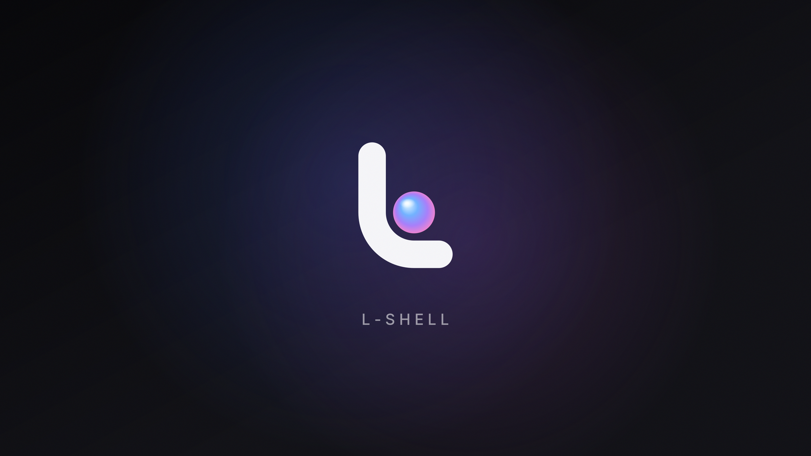
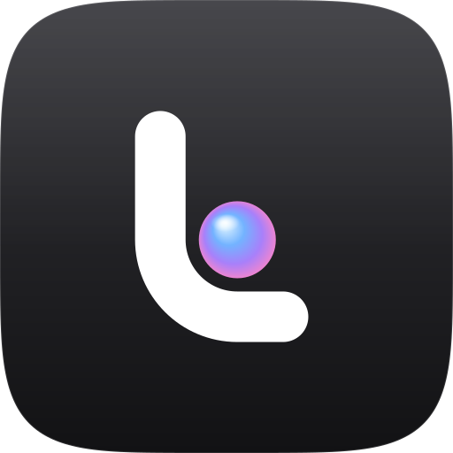

<p align="center">
  <picture>
    <source media="(prefers-color-scheme: dark)" srcset="assets/branding/l-shell-logo-dark.svg" />
    
  </picture>
</p>

<p align="center"><b>A calm, productive desktop shell for Wayland with one design of its own: Slate.</b><br/>
One menu bar with a live island in its middle, one material, one way to work.</p>

<p><br/></p>

<p align="center">
  
</p>

## The mark

The L-Shell mark is a **pearl in the corner**: a bold, rounded L whose corner runs in concentric arcs around an
iridescent pearl. The shell wraps the pearl the way L-Shell wraps your apps, and the concentric corner is the same
rule the whole UI follows (an inner radius is always the outer radius minus its padding). It reads as an "L", as a
window corner and as a shell holding something precious, and it stays legible down to a 16 px menu-bar glyph.

<p align="center">
  
</p>

Brand assets live in [`assets/branding/`](assets/branding) and are rendered by
[`tools/render-l-shell-brand.py`](tools/render-l-shell-brand.py).

## What makes it L-Shell

L-Shell has exactly one layout and one visual system, **Slate** (see [DESIGN.md](DESIGN.md)). There are no modes to
pick: the shell is designed as a whole, the way macOS or Windows are.

- **The menu bar.** Always there, flush with the top edge: the system menu (logo), numbered workspaces and the
  focused app on the left; tray, network, Bluetooth, volume, battery, search and Control Center on the right.
- **The island.** The bar's live middle. It shows the date and time; when something happens (volume, brightness,
  a new track, the charger, low battery, Wi-Fi or Bluetooth toggled) it grows below the bar for a moment and shows
  it. It replaces the floating OSD, so status always appears in one place. Hover while music plays to see the
  track; click to open Notification Center under it. Recording dots show when an app uses the camera, microphone
  or screen.
- **The dock.** On an empty workspace it is there; while you work it gets out of the way and the bottom edge brings
  it back. Running apps carry a signal line, the focused one in amber.
- **Slate.** One material for every surface (graphite at 84 % over blur, a 1 px hairline, a shadow only on what
  floats), a fixed palette with one amber signal accent, concentric radii and quiet motion. The wallpaper never
  recolours the shell; GTK, Qt, KDE, terminal and btop themes follow the same palette.
- **Spotlight.** A compact search field that opens instantly and finds apps, settings, calculations, emoji and more.
- **Mission Control and Expo.** `l-shell msg overview` shows the current workspace's windows; Expo shows every
  workspace on every monitor.
- **Session sheet.** Lock, sleep and log out as tiles over restart and shut down as wide buttons; keys 1–5.
- **Settings search.** Type what you want to change and Enter opens the settings window on exactly that setting.
- **Instant key bindings.** `l-shell-msg` is an IPC client that links only libc: bound to a key it answers in about
  2 ms, so Spotlight and Control Center appear the moment you press.

## Build and run

L-Shell builds like upstream Noctalia (C++23, Meson). Dependencies are listed in [BUILDING.md](BUILDING.md).

```sh
meson setup build-release --buildtype=release
meson compile -C build-release l-shell
./build-release/l-shell
```

L-Shell keeps everything separate from an installed Noctalia: its own executable (`l-shell`), config, state and cache
directories (`~/.config/l-shell`, `~/.local/state/l-shell`, `~/.cache/l-shell`), IPC socket and lock file. Both can be
installed side by side; only one should run at a time.

Useful commands:

```sh
l-shell-msg panel-toggle launcher        # Spotlight
l-shell-msg panel-toggle control-center  # Control Center
l-shell-msg overview                     # Mission Control
l-shell-msg settings-toggle              # System Settings
l-shell-msg panel-toggle session         # session sheet
```

Bind these to keys with `l-shell-msg` (not `l-shell msg`): it is the fast path. For Hyprland, see
[docs/user/compositor-settings/hyprland.mdx](docs/user/compositor-settings/hyprland.mdx), which also has the Slate
blur and window shadow settings.

## Staying current with Noctalia

The `Sync upstream Noctalia` workflow runs every day. When Noctalia's `main` has new commits it merges them on the
`upstream-sync` branch and opens a pull request into `main` (run it by hand from the Actions tab any time). A merge
that conflicts with L-Shell's changes arrives as plain upstream `main`, so the pull request shows what to resolve.

Locally:

```sh
git remote add upstream https://github.com/noctalia-dev/noctalia
git fetch upstream && git merge upstream/main
```

## Credits

L-Shell is a fork of [Noctalia](https://github.com/noctalia-dev/noctalia), a native Wayland desktop shell built
directly on Wayland and OpenGL ES. Nearly everything under the hood (bars, widgets, panels, services, theming, IPC)
comes from the Noctalia project and its contributors. Inter is by Rasmus Andersson (SIL Open Font License).

## License

MIT, like Noctalia. See [LICENSE](LICENSE).
